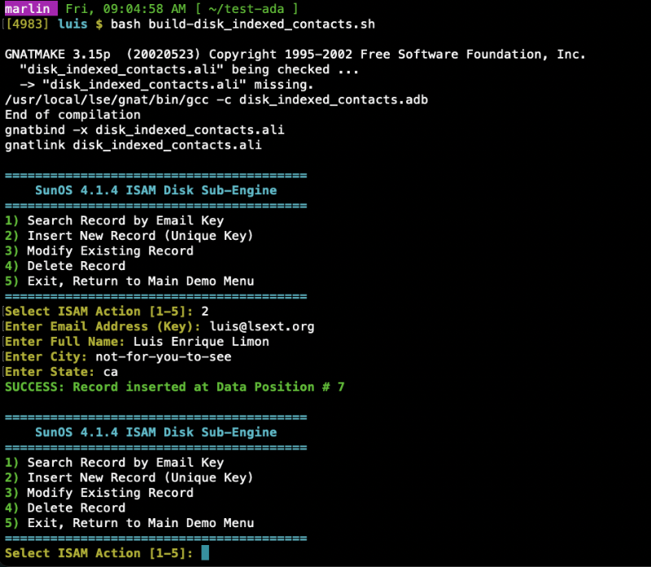

When I started the path of creating a group of cohesive and utilitarian packages for SunOS 4, I
decided earlier on that I wanted GNU-GNAT to be a centerpiece of it along with all the other
tools we come to expect on a modern Unix server.

From my previous experience adding GNAT to my Solaris LSE, I knew there was some challenge and
the first order of business was to FIND an Ada compiler. The reason is simple: one needs Ada
to compile GNAT. It needs itself.

The story says that long ago the first releases of GNAT used a commercial Ada compiler to create
the first build of GNAT, and from there it compiled itself.

So I turned to Google, then the Internet Archive, came out dry! Not a mention of GNAT
anywhere in SunOS. (I'll later discover why).

Then I figured it should be in one of the old CDs from Walnut Creek Inc. or a SunSite mirror.
Nothing! The earliest Ada compiler I knew about was `gnat-3.15p` for Solaris 2.5.1.

So I pivoted to try cross-compiling. I knew it was a thing, but I had never attempted such a
thing. Armed with the source code of `gnat-3.15p` and `gcc 2.8.1`, I could not find good
instructions on the internet of how to build Ada on GCC; probably lost like so many things
from that time.

I did my best. The first thing was to get `/usr/lib`, `/usr/include`, and `/usr/kvm` (this one
I learned about later from SunOS) and make them available for the cross-compiler. I put them
under `/opt/cross`.

Then one is supposed to copy Ada into the GCC folder, similar to how `g++` is built under
`2.8.1`, which I had done recently when I started LSE for SunOS 4.

After 5 days of fighting with it, I gave up, resigned to not having Ada, and concentrated on
building the LSE MVP.

When LSE for SunOS was almost ready, I decided to try a second time building GNAT. This time
I decided not to start until I could locate some kind of document explaining how to build it,
to avoid falling in the same trap.

Finding the document proved difficult. But oh... RTFM!!! It was right there in front of my
eyes the whole time. The source of Ada did have instructions for compiling Ada under GCC 2.8.1!

Looking back at my previous attempt, the one thing I missed is that unlike `g++`, one needs to
patch GCC to get it to integrate with GNAT.

## The Cross-Compiler

At first I didn't really understand what a cross-compiler is. One figures it's just a flag
when compiling like `gcc -target=SunOS` right? Nope!

In essence, what is done is to build a new compiler stack that is a binary of your build
system—in my case, Solaris 2.5.1 on an Ultra 60—but it "thinks" it is running on your target
platform, SunOS 4.1.4 on a v7 CPU. I'll link the SunOS objects and libraries.

Once I had GCC, Ada, and its companions, then it was time to build Ada. It was actually a
painful process because I learned `gnat-3.15p` does not build cleanly in SunOS 4. Looking back,
it makes sense why I was not able to find any binaries! Here comes `lsecompat` and my
experience building shims (adding missing functionality to vintage platforms).

The other problem I had was that as I was building and had a missing cross-compiler binary,
I had to retarget, build the binary, and then clean up my working folder from ELF binaries
to build the tool for SunOS (`a.out`).

This went on for some time. I even created a script to find and blast out bad objects.

Because a `make all` or something like that did not work for me during cross-compiling, I did
it the try, fail, and fix way.

I copied my binaries and attempted building my Ada demo, which is a contact database with
disk-based indexes. I needed among others the driver (`gcc`, `cc1` Ada-aware) and `gnatmake`.

Once I got everything working, I created a wrapper shell to make it work with my target folder
`/usr/local/lse` prefix. I could have rebuilt GNAT again now from SunOS, but why? My
cross-compiled binaries work just fine.

To showcase the compiler stack in action meetups, I set up the demo to trigger a
fresh build cycle via `gnatmake` on menu actions-giving older SPARC hardware a proper workout.

I created a `gnat-3.15p-SunOS-4.1.x.tar.gz` that should be dropped on `/usr/local/lse` along
with this document and a bundle with my cross-compiler, in case somebody needs to use it.
Probably not useful to anybody, but I cannot see the future, so better keep it around.

- Luis Enrique Limon, Oct 17, 2026
