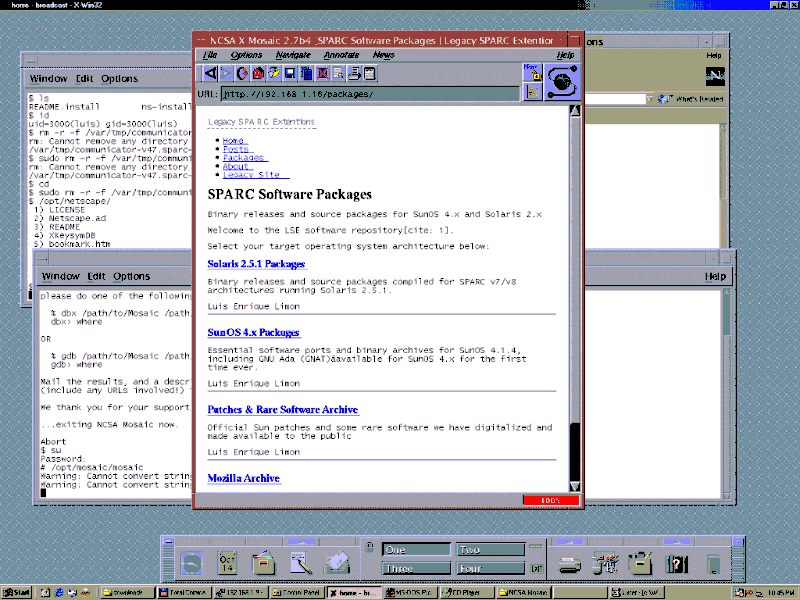

Besides of working on the software ports to vintage SPARc Os. We really wanted to create 
a modern website that at the same site can be used with retro web browsers down to NCSA Mosaic!
It tock some effort and tears. I think we made it!

You can see from the screenshot. Is fully functional and looks period correct.

It will also work in Netscape 4.5 and up.
We hope you enjoy using it and have good use for it. We plan to have technical articles, Focused on 
Vintage Workstations but we are not limiting to it.

The trick?

When Mosaic does not understand CCS, Java or schema (Ok just HMTL 2.0;) it drops it into the page content, 
Making for a terrible read  and when it encounters a html tag it judges as invalid and is completely, like is not there...

So we used this to our advantage. 

* Instead of the common inline java:
```html
<script type="text/javascript">
  function HelloWorldApplication() {
      this.greeting = "Hello World from LSExt.org!";
  }

  HelloWorldApplication.prototype.execute = function() {
      alert(this.greeting);
  };

  var app = new HelloWorldApplication();
  app.execute();
</script>
```
* we changed it to load from an external file.
```html
<script src="/static/hello.js"></script>
```

* For inline CSS, the creators were smart and allowed html comments inside CSS. ; this let us to trick  Mosacic and Netscape into treating CCS as comments.


